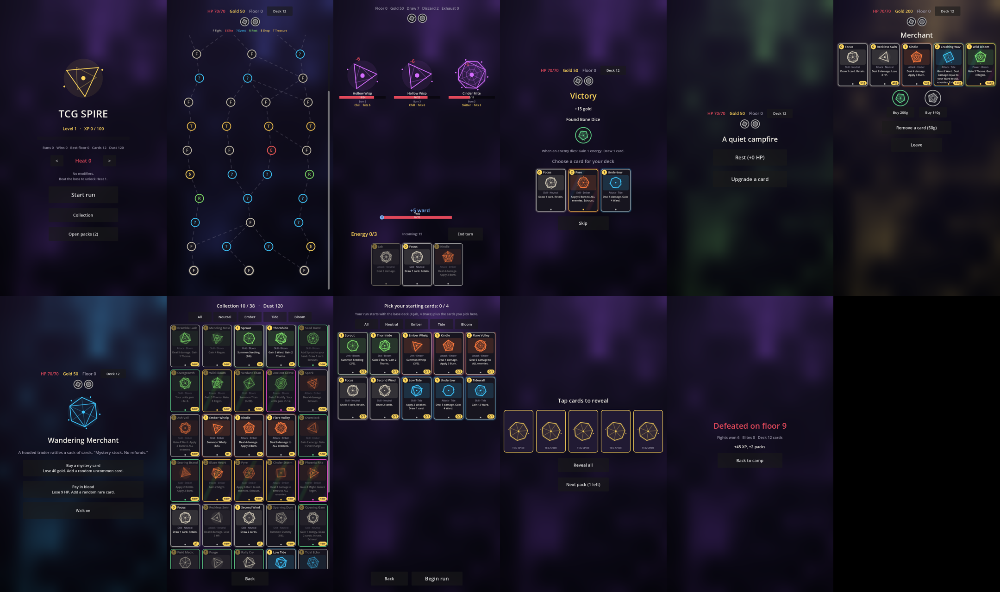

# TCG Spire

An original card roguelike for Android with a collectible-card meta: build a
collection between runs, pick a few cards from it to seed each run, draft the
rest as you climb, and earn packs by playing.

Built with Godot 4.4. All visuals are code (procedural sigils, shaders, typography),
so there's very little hand-made art to maintain.

## Status
Playable on Android (debug builds on the Releases page):
- Neon Undercity setting: you're a Ghost running hacking jobs for one of six crews against its rival
- 3 acts on a seeded branching map with walls, vaults and jumps; fights, elites, events, safehouses, fixers and caches
- 7 crews (Street plus six) with 221 programs, joint ops between crews, daemons that bend the rules, 51 implants
- 36 crew Cores (two per crew per act) plus neutral bosses, with boss rules like phases, twins, pylons and signal jams
- Collection meta: caches (normal, Zero-day and crew), crafting and scrap, firmware upgrades, binders, saved loadouts
- Long-term progression: XP levels, card mastery, crew rep and rig upgrades, Heat 0-6, Deep Stack
- Daily breach, weekly challenge, daily login bonus, records and an ICE database of every enemy you've fought

## Develop
Open the folder in Godot 4.4 and press Play, or from a shell:

    scripts/test.sh      # tests + smoke boot
    scripts/cards.sh     # card list
    scripts/sim.sh       # balance sim

See `CLAUDE.md` for architecture and conventions.
