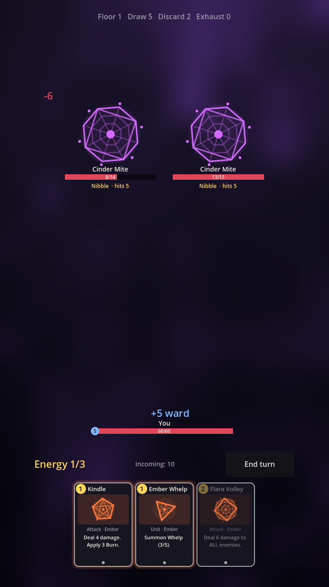

# TCG Spire

An original card roguelike for Android with a collectible-card meta: build a
collection between runs, pick a few cards from it to seed each run, draft the
rest as you climb, and earn packs by playing.

Built with Godot 4.4. All visuals are code (procedural sigils, shaders, typography),
so there's very little hand-made art to maintain.

## Status
Prototype: combat (cards, units on a 3-slot board, statuses, enemy intents),
3-fight route with card rewards, packs + collection + dust, versioned saves.
Next: map, more factions/enemies, deck-picker screen, Android export.

## Develop
Open the folder in Godot 4.4 and press Play, or from a shell:

    scripts/test.sh      # tests + smoke boot
    scripts/cards.sh     # card list
    scripts/sim.sh       # balance sim

See `CLAUDE.md` for architecture and conventions.
