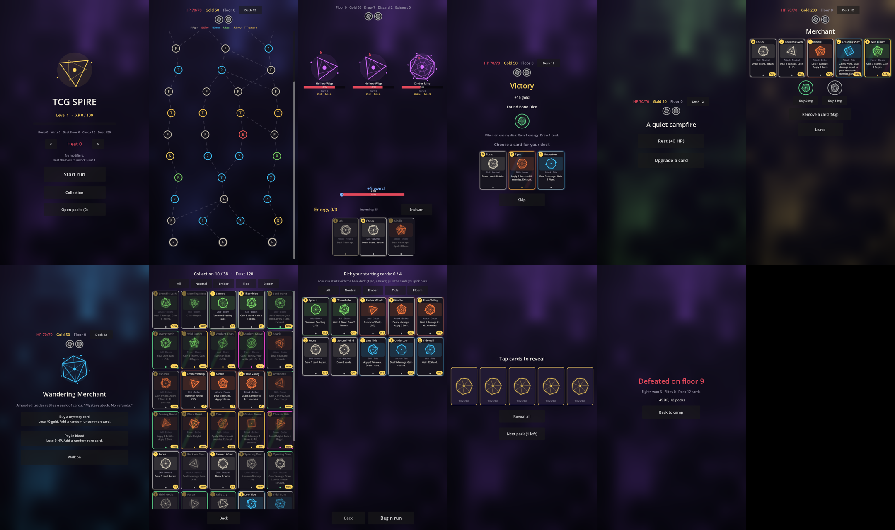

# TCG Spire

An original card roguelike for Android with a collectible-card meta: build a
collection between runs, pick a few cards from it to seed each run, draft the
rest as you climb, and earn packs by playing.

Built with Godot 4.4. All visuals are code (procedural sigils, shaders, typography),
so there's very little hand-made art to maintain.

## Status
Playable act 1 prototype:
- Branching seeded map with fights, elites, events, rest sites, shops, treasure and 2 bosses
- 4 factions (Neutral, Ember, Tide, Bloom), 40 cards, units on a 3-slot board, 8 statuses
- 15 talismans with trigger hooks, 6 events, curses
- Collection with crafting/disenchanting, pack opening, a pre-run deck picker
- Long-term progression: account levels, card mastery (dust, then a foil copy), 6 heat levels
Next: act 2, more factions, Android export.

## Develop
Open the folder in Godot 4.4 and press Play, or from a shell:

    scripts/test.sh      # tests + smoke boot
    scripts/cards.sh     # card list
    scripts/sim.sh       # balance sim

See `CLAUDE.md` for architecture and conventions.
